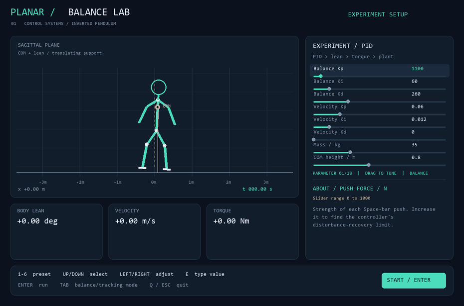
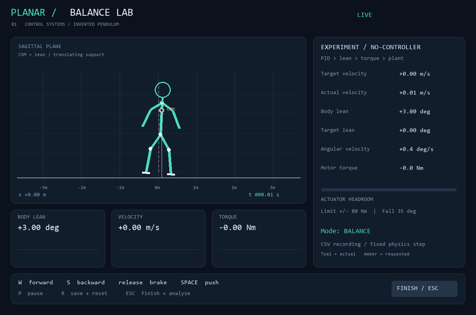
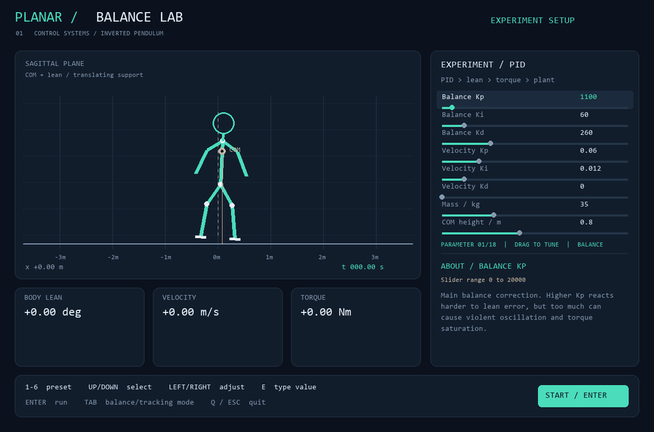

# Planar / Balance Lab

An interactive 2D robot-balance simulator. Tune a cascaded PID controller, push the robot, watch it recover or fall, and inspect the evidence after every run.







The robot is a simplified inverted pendulum. W/S requests velocity; the controller chooses lean and torque. Space applies an external push. The stickman can fall by design: the experiment is to find the controller's recovery limit.

## Quickstart

Windows:

```powershell
.\launch.bat
```

Press Enter to start. Hover over a parameter for an explanation, then drag its slider and run again. On a fresh checkout, install the local runtime once:

```powershell
powershell -ExecutionPolicy Bypass -File .\setup.ps1
```

With an existing Python 3.10+ install:

```powershell
python -m venv .venv
.\.venv\Scripts\python -m pip install -r requirements.txt
python main.py
```

## Try this first

1. Start with the default PID and press Space.
2. Raise **Push force / N** and run again.
3. Lower **Torque limit / Nm** until the robot saturates or falls.
4. Select `2` (no controller), `3` (P-only), or `4` (excessive gain).
5. Press Escape. The analysis dashboard shows the response, metrics, and a tuning suggestion.

The loop is deliberately simple:

```text
velocity command -> velocity PID -> desired lean -> balance PID -> torque limit -> robot dynamics
```

## Controls

| Input | Action |
| --- | --- |
| Enter / Start | Begin the configured run |
| W / S | Request forward / backward velocity |
| Space | Apply the configured push |
| P | Pause or resume |
| R | Save and reset for another run |
| Escape | End the run and open analysis |
| Mouse hover | Explain a setup parameter |
| Mouse drag | Tune a visible setup slider |
| Up / Down | Move through parameter pages |
| Left / Right | Nudge the selected parameter |
| E | Enter an exact parameter value |
| 1-6 | Load a comparison preset |
| Enter / C on analysis | Continue testing |
| Q / Escape on analysis | Exit |

## Presets

`1` PID recovery, `2` no controller, `3` P-only, `4` excessive gain, `5` large disturbance, `6` velocity tracking.

Run the complete deterministic comparison without opening a window:

```powershell
.\launch.bat --suite
```

Other useful commands:

```powershell
.\launch.bat --headless --preset tracking
.\launch.bat --headless --preset large-disturbance
.\.runtime\python.exe -m unittest discover -s tests -v
```

## Run artifacts

Each experiment gets its own folder:

```text
runs/run1/
  data.csv       timestep log
  config.json    parameters and model metadata
  summary.json   metrics and event results
  report.png     post-run plots
```

Folders increment to `run2`, `run3`, and so on. Generated runs are ignored by Git.

## Model

The state is `[lean angle, angular velocity, position, velocity]`. The plant uses explicit nonlinear equations and fixed-step RK4 integration. Gravity destabilizes upright balance; torque is limited to a finite actuator range. Translation is a compact lean-to-acceleration approximation, not a full cart-pole or humanoid contact model.

Defaults: 35 kg, 0.8 m COM height, 9.81 m/s2 gravity, +/-80 Nm torque, +/-35 degree fall boundary, and 0.01 s physics step.

## Project map

```text
main.py                 interactive app and experiment runner
simulator/              state, dynamics, environment
controllers/            balance and velocity PID loops
visualization/          Pygame renderer and dashboard
analysis/               CSV logging, metrics, report plots
config/                 validated defaults and presets
tests/                  physics, controller, metrics, and UI checks
assets/                 README demonstration GIFs
```

The reference design favors a concise overview, a quickstart, and visual evidence; deeper implementation notes live in the source and generated run reports. See the [reference simulator README](https://github.com/shun-ren/drone_sim) for the style this layout follows.
